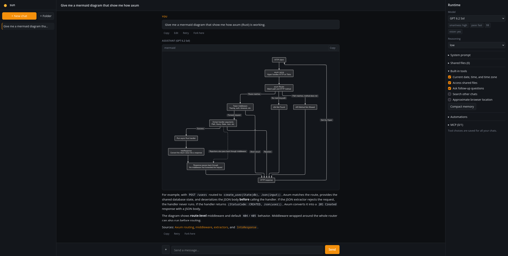

# Sun 🌞

Lightweight AI chat in Rust. A minimal alternative to Open WebUI and LibreChat.



## Quick start

1. From the project directory, run:

   ```sh
   cp -n config.example.toml config.toml
   cp -n .env.example .env
   ```

2. Set `[llm].base_url` and `[[llm.models]]` IDs in `config.toml`; set `SUN_LLM_API_KEY` in `.env`.
3. Run `docker compose up -d --build` and open [localhost:3030](http://localhost:3030).

Set `SUN_LISTEN=127.0.0.1:3030` in `.env` for local-only use. Enable `[auth]` and configure your OIDC provider before exposing Sun.

## Features

- **Chat:** OpenAI-compatible APIs, streaming, vision, file attachments, Markdown, LaTeX and Mermaid.
- **Workspace:** Folders, shared files, temporary chats, chat forking, context compaction and scheduled prompts.
- **Tools:** MCP over Streamable HTTP; date, time and time zone; follow-up questions; chat search; approximate browser location with consent.
- **Deployment:** Provider-agnostic OIDC, hot-reloaded app settings, configurable name/logo/colors and a mobile-friendly web app with home-screen support.

## Benchmarks

| App | Containers | Images | Idle RAM | Startup | `GET /` |
| --- | ---: | ---: | ---: | ---: | ---: |
| **Sun** | **1** | **84.5 MiB** | **7.5 MiB** | **0.29 s** | **0.32 ms** |
| Open WebUI | 1 | 6.00 GiB | 708 MiB | 14.73 s | 1.33 ms |
| LibreChat + MongoDB | 2 | 4.76 GiB | 907 MiB | 3.18 s | 0.69 ms |

Local Docker on Linux amd64 (Ryzen 9 7940HX, 32 GiB), 2026-11-22. Medians of three fresh launches, images already present. Startup includes container creation; idle RAM is from `docker stats`; images are uncompressed totals. `GET /` is loopback HTTP (30 requests per launch).

Open WebUI `main` (`0666e59`, offline, no Ollama); LibreChat `v0.8.7` + MongoDB `8.0.20` (no optional search or RAG services).

## Design

Sun exists because self-hosting a chat UI for models you already use shouldn't require a separate database or a stack of services. Fast startup and low idle memory come first. Sun keeps everyday chat features built in and connects to specialized tools through MCP without adding dependencies to every installation.

- **Deploy:** One Rust binary in a Linux container, file-backed storage, hot-reloaded TOML and secrets in environment variables.
- **Serve:** [Tokio](https://tokio.rs/) and [Axum](https://github.com/tokio-rs/axum) handle async HTTP; [Maud](https://maud.lambda.xyz/) compiles server-rendered templates. Minimal JavaScript, no client framework.
- **Connect:** [reqwest](https://crates.io/crates/reqwest) and [rustls](https://crates.io/crates/rustls) for HTTPS and model streaming, [openidconnect](https://crates.io/crates/openidconnect) for sign-in, and [rmcp](https://crates.io/crates/rmcp) for tools.
- **Render:** [Xberg](https://github.com/xberg-io/xberg) extracts documents; [pulldown-cmark](https://crates.io/crates/pulldown-cmark), [pulldown-latex](https://crates.io/crates/pulldown-latex) and [Flowmaid](https://crates.io/crates/flowmaid) render Markdown, math and Mermaid on the server.

Agents: [AGENTS.md](AGENTS.md).

License: [AGPL-3.0-or-later](LICENSE).
